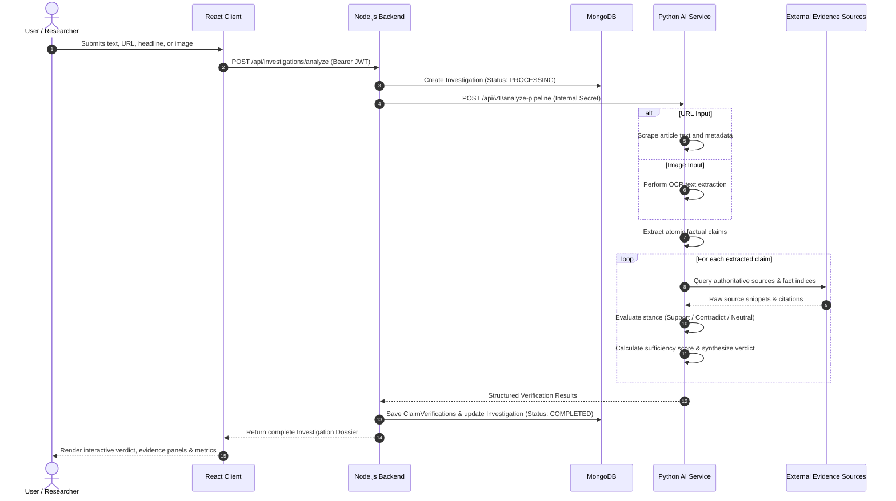

# TruthLens – System Architecture & Technical Specifications

> **Tagline:** *"Don't Just Believe It. Verify It."*

---

## 1. Executive Summary

**TruthLens** is an evidence-first information verification platform. Designed for journalists, researchers, policy analysts, and vigilant citizens, TruthLens ingests claims from diverse modalities (plain text, headlines, article URLs, and uploaded document/social media images), decomposes them into atomic, testable factual claims, retrieves corroborating and contradicting evidence from authoritative sources, compares viewpoints, and delivers an auditable, transparent assessment.

### Core Tenet: Zero Hallucination & Evidence-Bound Reasoning
TruthLens adheres to strict epistemic standards:
- **No invented sources or URLs:** Every citation must be a verified, retrieved source.
- **No fabricated quotes:** Quoted evidence must be extracted verbatim or accurately paraphrased with explicit markers.
- **Explicit Uncertainty & Insufficient Evidence:** If evidence is inadequate or contradictory without consensus, the platform marks the claim **UNVERIFIED** rather than guessing.
- **Separation of Fact vs. Opinion:** Opinions and subjective value judgments are classified as non-verifiable statements rather than marked false.

---

## 2. High-Level System Architecture

TruthLens is engineered as a decoupled, three-tier service architecture:

```
┌────────────────────────────────────────────────────────┐
│                   React Frontend                       │
│        (Vite + React.js + Tailwind CSS + Framer)       │
│           Strict Editorial Light Theme System          │
└───────────────────────────┬────────────────────────────┘
                            │ HTTPS / REST (JWT)
                            ▼
┌────────────────────────────────────────────────────────┐
│                Main Backend (Node.js)                  │
│               (Express.js + Mongoose)                  │
│  - User Auth & RBAC (bcrypt + JWT)                     │
│  - Investigation Lifecycle & State Machine             │
│  - Saved Reports & Bookmarks                           │
│  - PDF Export Engine (Puppeteer/PDFKit)                │
│  - Rate Limiting & Input Validation                    │
└──────────────┬──────────────────────────┬──────────────┘
               │                          │
               │ Mongoose / ODM           │ Internal HTTP / REST
               ▼                          │ (Shared Secret Key)
┌──────────────────────────┐              ▼
│     MongoDB Database     │ ┌───────────────────────────┐
│                          │ │     AI Service (Python)   │
│ - Users & Roles          │ │ (FastAPI + Pydantic + NLP)│
│ - Investigations         │ │ - Claim Extraction (NLP)  │
│ - Claim Verifications    │ │ - Evidence Search & Fetch │
│ - Saved Reports & Logs   │ │ - Source Stance & Synthesis│
└──────────────────────────┘ │ - Multi-modal OCR & URL   │
                             └──────────────┬────────────┘
                                            │
                                            ▼ External Evidence Providers
                             ┌───────────────────────────┐
                             │ - Trusted Fact-Check APIs │
                             │ - Live Search & News APIs │
                             │ - Academic / Archive Orgs │
                             └───────────────────────────┘
```

---

## 3. Service Roles & Boundaries

### 3.1. Frontend Service (React / Vite)
- **Role:** Delivers an editorial, research-grade user experience with intuitive claim submission, dynamic investigation progress tracking, interactive evidence side-by-side comparisons, and printable reporting.
- **Styling Discipline:** Strict Light Theme only (#F7F9FC canvas, #FFFFFF cards, #2457D6 primary blue, #12A88A teal, #F28A45 accent). Plus Jakarta Sans headings and Inter body. No dark dashboard modes or generic SaaS gradients.
- **State Management:** React Context + Custom Hooks for authenticated sessions and live verification pipelines.

### 3.2. Main Backend (Node.js / Express)
- **Role:** Gatekeeper, business logic orchestrator, and database persistence manager.
- **Responsibilities:**
  - Secure authentication (bcrypt password hashing, stateless JWT tokens with refresh mechanism).
  - Validation of user submissions (text length, URL sanitization, file size/MIME type for image OCR).
  - Orchestrating multi-step verification by calling the Python AI service.
  - Generating exportable verification dossiers (branded PDF reports).
  - Enforcing rate limiting, audit logging, and authorization boundaries.

### 3.3. AI & Verification Engine (Python / FastAPI)
- **Role:** Computational linguistics, factual claim extraction, retrieval-augmented verification, and structured synthesis.
- **Core Pipeline Modules:**
  1. **Claim Extractor:** Parses complex texts, transcripts, or headlines into discrete, falsifiable factual propositions using NLP and prompt-guided LLM parsing.
  2. **URL Scraper & Ingestor:** Resolves URLs, strips boilerplate/ads, and extracts article text, author, and timestamp.
  3. **OCR Engine:** Processes screenshots or images using Tesseract / OCR pipelines to extract embedded textual claims.
  4. **Evidence Retrieval Broker:** Queries live news indices, fact-checking registries (e.g., PolitiFact, FactCheck.org, Snopes, Reuters, AP), and web search providers to collect relevant source documents.
  5. **Verification & Stance Synthesizer:** Classifies source snippets into Supporting, Contradicting, or Neutral; computes source credibility weights; determines evidence sufficiency; and formats the final verdict with explicit limitations.

---

## 4. End-to-End Investigation Lifecycle



---

## 5. Visual Design System Specifications

| Token | Hex Value | Semantic Purpose |
|---|---|---|
| **Canvas Background** | `#F7F9FC` | Ultra-clean, distraction-free neutral backdrop |
| **Card / Surface Background** | `#FFFFFF` | Elevated editorial cards, evidence containers |
| **Primary Blue** | `#2457D6` | Primary CTAs, active indicators, brand identity |
| **Secondary Teal** | `#12A88A` | Credibility markers, verified indicators, supporting evidence |
| **Accent Orange** | `#F28A45` | Attention highlights, mixed claims, secondary focus |
| **Main Text** | `#172B4D` | Deep slate for editorial contrast and high legibility |
| **Secondary Text** | `#64748B` | Subtle metadata, timestamps, author bylines |
| **Border Color** | `#E5EAF2` | Hairline dividers, crisp container boundaries |
| **Success Color** | `#16865D` | "TRUE", "MOSTLY TRUE" verdict badges |
| **Warning Color** | `#D68A22` | "MIXED", "UNVERIFIED" verdict badges |
| **Error Color** | `#D64B55` | "FALSE", "MOSTLY FALSE" verdict badges |

### Typography Guidelines
- **Headings (Display, H1-H4):** `Plus Jakarta Sans`, font-weights `600`, `700`, `800`.
- **Body & Metadata:** `Inter`, font-weights `400`, `500`, `600`.
- **Monospace (Citations, IDs, Hash):** `JetBrains Mono` or system mono.

