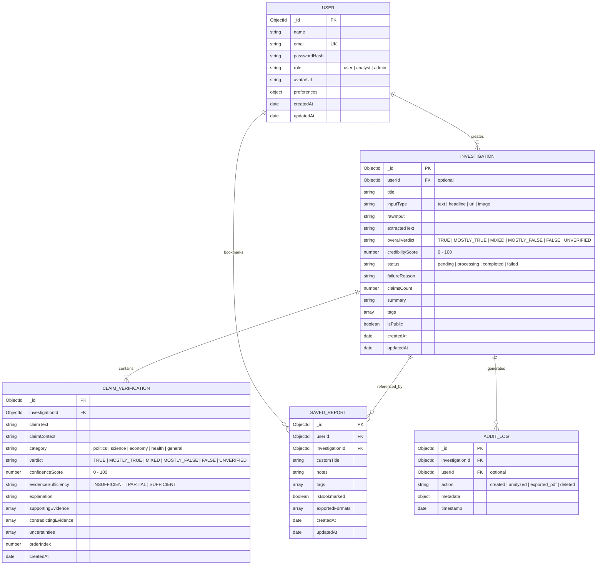

# TruthLens – Database Schema & Data Models

This document defines the database architecture, entity-relationship diagrams, and Mongoose schema specifications for TruthLens on MongoDB.

---

## 1. Entity-Relationship Overview



---

## 2. Collection Specifications

### 2.1. `users` Collection
Stores registered accounts, credential hashes, roles, and profile settings.

```javascript
const UserSchema = new mongoose.Schema({
  name: {
    type: String,
    required: [true, 'Full name is required'],
    trim: true,
    maxlength: 100
  },
  email: {
    type: String,
    required: [true, 'Email is required'],
    unique: true,
    lowercase: true,
    trim: true,
    index: true,
    match: [/^\S+@\S+\.\S+$/, 'Invalid email address format']
  },
  passwordHash: {
    type: String,
    required: [true, 'Password hash is required'],
    select: false
  },
  role: {
    type: String,
    enum: ['user', 'analyst', 'admin'],
    default: 'user'
  },
  avatarUrl: {
    type: String,
    default: null
  },
  preferences: {
    trustedSourcesOnly: { type: Boolean, default: false },
    preferredEvidenceLanguage: { type: String, default: 'en' },
    emailNotifications: { type: Boolean, default: false }
  }
}, {
  timestamps: true
});
```

### 2.2. `investigations` Collection
Represents a single fact-checking session initiated by a user or guest.

```javascript
const InvestigationSchema = new mongoose.Schema({
  userId: {
    type: mongoose.Schema.Types.ObjectId,
    ref: 'User',
    default: null,
    index: true
  },
  title: {
    type: String,
    required: true,
    trim: true,
    maxlength: 250
  },
  inputType: {
    type: String,
    enum: ['text', 'headline', 'url', 'image'],
    required: true
  },
  rawInput: {
    type: String,
    required: true
  },
  extractedText: {
    type: String,
    default: ''
  },
  sourceMetadata: {
    sourceUrl: { type: String, default: null },
    author: { type: String, default: null },
    publishedDate: { type: Date, default: null },
    domain: { type: String, default: null }
  },
  status: {
    type: String,
    enum: ['pending', 'processing', 'completed', 'failed'],
    default: 'pending',
    index: true
  },
  failureReason: {
    type: String,
    default: null
  },
  overallVerdict: {
    type: String,
    enum: ['TRUE', 'MOSTLY_TRUE', 'MIXED', 'MOSTLY_FALSE', 'FALSE', 'UNVERIFIED', null],
    default: null
  },
  credibilityScore: {
    type: Number,
    min: 0,
    max: 100,
    default: null
  },
  summary: {
    type: String,
    default: ''
  },
  claimsCount: {
    type: Number,
    default: 0
  },
  tags: [{
    type: String,
    trim: true
  }],
  isPublic: {
    type: Boolean,
    default: false,
    index: true
  }
}, {
  timestamps: true
});
```

### 2.3. `claim_verifications` Collection
Stores granular claims extracted from an investigation and their evidence-based evaluation.

```javascript
const EvidenceItemSchema = new mongoose.Schema({
  title: { type: String, required: true },
  quote: { type: String, required: true },
  sourceName: { type: String, required: true },
  sourceUrl: { type: String, required: true },
  publishDate: { type: String, default: null },
  credibilityTier: {
    type: String,
    enum: ['HIGH', 'MEDIUM', 'LOW', 'UNKNOWN'],
    default: 'MEDIUM'
  },
  stance: {
    type: String,
    enum: ['SUPPORTS', 'CONTRADICTS', 'NEUTRAL'],
    required: true
  },
  relevanceScore: {
    type: Number,
    min: 0,
    max: 1
  }
}, { _id: false });

const ClaimVerificationSchema = new mongoose.Schema({
  investigationId: {
    type: mongoose.Schema.Types.ObjectId,
    ref: 'Investigation',
    required: true,
    index: true
  },
  claimText: {
    type: String,
    required: true,
    trim: true
  },
  claimContext: {
    type: String,
    default: ''
  },
  category: {
    type: String,
    enum: ['politics', 'science', 'economy', 'health', 'technology', 'general'],
    default: 'general'
  },
  verdict: {
    type: String,
    enum: ['TRUE', 'MOSTLY_TRUE', 'MIXED', 'MOSTLY_FALSE', 'FALSE', 'UNVERIFIED'],
    required: true
  },
  confidenceScore: {
    type: Number,
    min: 0,
    max: 100,
    required: true
  },
  evidenceSufficiency: {
    type: String,
    enum: ['INSUFFICIENT', 'PARTIAL', 'SUFFICIENT'],
    required: true
  },
  explanation: {
    type: String,
    required: true
  },
  supportingEvidence: [EvidenceItemSchema],
  contradictingEvidence: [EvidenceItemSchema],
  uncertainties: [{
    type: String
  }],
  orderIndex: {
    type: Number,
    default: 0
  }
}, {
  timestamps: true
});
```

### 2.4. `saved_reports` Collection
Allows users to curate, bookmark, add personal analytical notes, and track export history.

```javascript
const SavedReportSchema = new mongoose.Schema({
  userId: {
    type: mongoose.Schema.Types.ObjectId,
    ref: 'User',
    required: true,
    index: true
  },
  investigationId: {
    type: mongoose.Schema.Types.ObjectId,
    ref: 'Investigation',
    required: true
  },
  customTitle: {
    type: String,
    trim: true
  },
  notes: {
    type: String,
    default: ''
  },
  tags: [{
    type: String,
    trim: true
  }],
  isBookmarked: {
    type: Boolean,
    default: true
  },
  exportedFormats: [{
    type: String,
    enum: ['pdf', 'json', 'csv']
  }]
}, {
  timestamps: true
});

// Composite unique index to avoid duplicate bookmarks
SavedReportSchema.index({ userId: 1, investigationId: 1 }, { unique: true });
```

